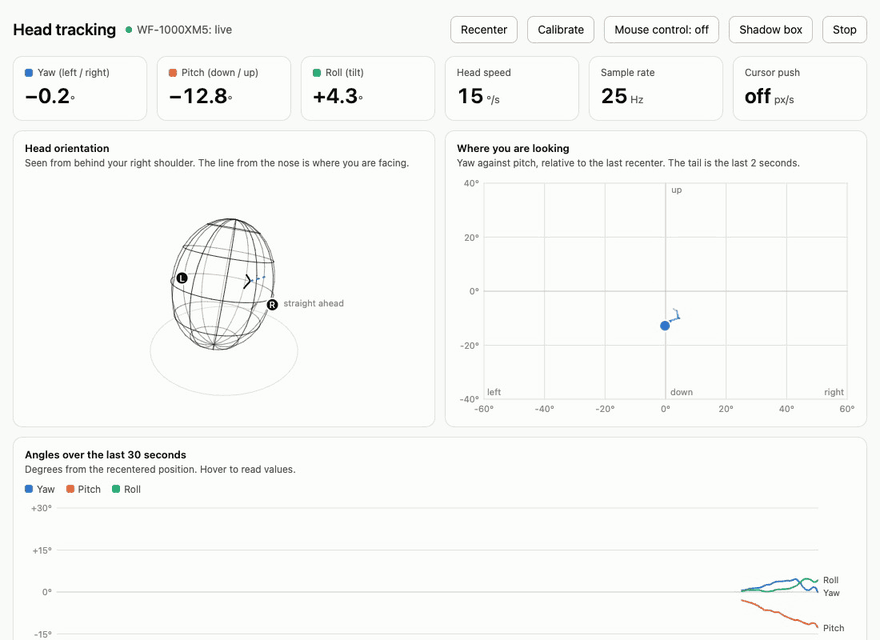
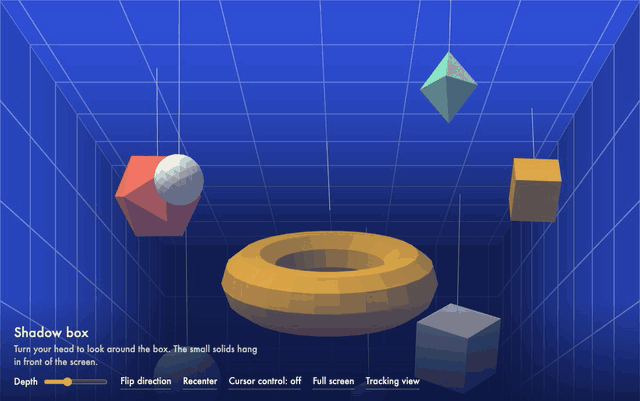

# sonymouse

Head tracking on macOS with Sony earbuds and headphones that speak Android's head-tracker HID protocol.
Tested with the WF-1000XM5.

- Move the Mac cursor by turning your head.
- Watch the tracking live in a browser page.
- Look around a 3D box that shifts with your head (parallax window effect).

The live tracking page, driven by a pair of WF-1000XM5:



The 3D box, re-projected as the head turns:



## Use

Requires [uv](https://docs.astral.sh/uv/) and the earbuds connected to the Mac.

```bash
uv run sonymouse.py --calibrate     # once: learn which way is right and up
uv run sonymouse.py                 # move the cursor with your head, Ctrl+C to stop
uv run sonymouse.py --dwell 0.8     # also click after holding still for 0.8 s
uv run sonymouse.py --viz           # also serve the live pages at http://127.0.0.1:8765
uv run sonymouse.py --diag          # print motion only, never touch the cursor
```

Pages served by `--viz`:

- `/` shows the head orientation, where you are looking, and the angles over time. It has buttons to
  calibrate, recenter, switch cursor control on or off, and stop the tracker.
- `/parallax` is the 3D box.

Other options: `--speed` (pixels per degree), `--deadzone` (°/s ignored), `--smooth` (seconds).

Posting mouse events needs the Accessibility permission for your terminal (System Settings > Privacy &
Security > Accessibility). Without it the cursor still moves, but dwell clicks are off.

The calibration is saved to `~/.config/sonymouse/axes.json`. Calibrate again if the cursor starts moving
at a slant after you reseat the earbuds.

## How it works

The earbuds appear as a HID sensor device (usage page `0x20`, usage `0xE1`).

| Report | Content |
|---|---|
| Feature report 2 (read) | `#AndroidHeadTracker#1.0` and the device address |
| Feature report 1 (write) | `01 03` switches tracking on, `01 00` off |
| Input report 1 | rotation vector, 3 × int16 LE, ±32767 = ±π rad, about 25 Hz |

Only rotation is reported, so leaning without turning the head cannot be detected, and yaw drifts slowly.

## Credits

The head-tracker protocol used here was reverse-engineered by Nicholas Slattery in
[sony-head-tracker](https://github.com/NicholasSlattery/sony-head-tracker).

Written with reference to [MousePods](https://github.com/starman-tech/mousepods) by Matteo Gaudioso
(starman-tech).
